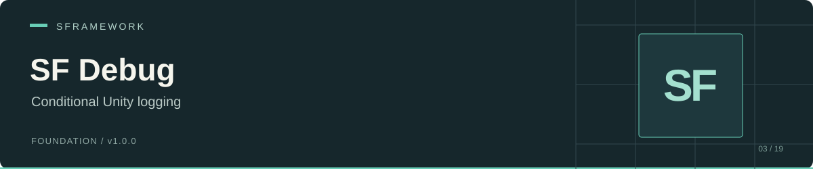

# SF Debug

[Documentation website](https://docs.secretplace.studio/#sf-debug)

 

SF Debug wraps Unity logging with a runtime debug flag. Use it to control ordinary log messages during Play Mode and player execution, while keeping exception reporting available.

The package contains one static class: `SFramework.Debug.Runtime.SFDebug`. It forwards messages to `UnityEngine.Debug`; it adds no log storage, logger registry, or settings asset.

## Installation

In Unity Package Manager, choose **Add package from git URL**:

```text
https://github.com/huran438/sf-debug.git#main
```

Alternatively, add this entry to the `dependencies` object in `Packages/manifest.json`:

```json
"sp.sframework.debug": "https://github.com/huran438/sf-debug.git#main"
```

The [manifest](package.json) does not declare dependencies or a minimum Unity version. The [runtime assembly definition](Runtime/SFramework.Debug.Runtime.asmdef) has no explicit assembly references and keeps Unity engine references enabled. The source also uses `JetBrains.Annotations.StringFormatMethod`; your Unity environment must supply that namespace.

If your application uses an assembly definition, reference `SFramework.Debug.Runtime`. Verify compilation in your target editor; package metadata does not establish compatibility with a particular Unity release.

## Example

Create `ExampleDebug.cs` and add the component to a scene GameObject:

```csharp
using System;
using UnityEngine;
using SFDebug = SFramework.Debug.Runtime.SFDebug;

public sealed class ExampleDebug : MonoBehaviour
{
    [SerializeField] private bool _enableDebug = true;

    private void Awake()
    {
        SFDebug.SetDebug(_enableDebug);
        SFDebug.Log("Scene started: {0}", LogType.Log, gameObject.scene.name);
        SFDebug.Log("Example component: {0}", this, LogType.Warning, name);
    }

    public void ReportError(Exception exception)
    {
        SFDebug.Exception(exception, this);
    }
}
```

Choose the project's flag value before logging in Play Mode. The example uses an explicit `LogType` to select the severity overload. Format arguments use Unity's composite formatting, such as `{0}` and `{1}`. The context overload links the log message to a Unity object in the Console.

## Logging rules

The source computes `CanLog` as `!Application.isPlaying || IsDebug`.

| Execution state | `IsDebug` | `Log` calls |
| --- | --- | --- |
| Outside Play Mode | `false` or `true` | Forwarded to Unity logging. |
| Play Mode or running player | `false` | Skipped. |
| Play Mode or running player | `true` | Forwarded to Unity logging. |

`IsDebug` starts as the default Boolean value, `false`, when the static state initializes. `SetDebug(bool)` changes it for subsequent calls. The class has no runtime initialization hook that resets the flag, so explicitly set it at your application entry point when static state can survive Play Mode transitions.

`Exception` bypasses the debug flag and calls `UnityEngine.Debug.LogException` in both overloads. Unity's own logging configuration still governs how Unity presents the forwarded messages.

## API

All members belong to `SFramework.Debug.Runtime.SFDebug`.

| Member | Behavior |
| --- | --- |
| `bool IsDebug { get; }` | Read the current flag. The setter is private. |
| `void SetDebug(bool isDebug)` | Change the flag. |
| `void Log(string message, params object[] args)` | Log at `LogType.Log` when the gate permits it. |
| `void Log(string message, LogType logType = LogType.Log, params object[] args)` | Choose the Unity log severity. |
| `void Log(string message, UnityEngine.Object context, LogType logType, params object[] args)` | Choose context and severity. |
| `void Exception(Exception exception)` | Report an exception regardless of the gate. |
| `void Exception(Exception exception, UnityEngine.Object context)` | Report an exception with a Unity context, regardless of the gate. |

## Integration and troubleshooting

[SF Core](https://github.com/huran438/sf-core) references this package's assembly, but also defines a different `SFramework.Core.Runtime.SFDebug` class with its own logger registry and flag. Setting the flag here does not set Core's flag. Use an alias, as in the example, when your code imports both namespaces.

If a message disappears during Play Mode, check `IsDebug` and the namespace alias. If messages still appear outside Play Mode after `SetDebug(false)`, that follows the `!Application.isPlaying` rule. If an exception appears with debugging disabled, `Exception` deliberately bypasses the gate.

The gate runs inside `Log`. Calling code evaluates arguments before it enters the method, so expensive message creation still happens even for a skipped call. Check `IsDebug` in the caller if you need to avoid that work during Play Mode.

The package supplies no severity filter beyond each call's `LogType`, no persisted flag, and no build-symbol configuration. Your project decides where and when to call `SetDebug`.

## Repository map

| Source | Responsibility |
| --- | --- |
| [Runtime/SFDebug.cs](Runtime/SFDebug.cs) | Debug flag, log overloads, exception forwarding. |
| [Runtime/SFramework.Debug.Runtime.asmdef](Runtime/SFramework.Debug.Runtime.asmdef) | Assembly identity. |
| [package.json](package.json) | Package identity and version. |
| [LICENSE.md](LICENSE.md) | MIT terms. |

## Related modules, validation, and license

See [SF Core](https://github.com/huran438/sf-core) for the service container and its separate logger facade. [SF Bootstrap](https://github.com/huran438/sf-bootstrap) provides startup hooks where an application can configure runtime behavior.

This README describes source snapshot `7c169dfad878f93af4ebc7bfde2747ff5d87432e`. The example was inspected statically against the source; it was not compiled or executed in Unity. Verify Console output in the host project and your intended player build.

MIT License. See [LICENSE.md](LICENSE.md).
